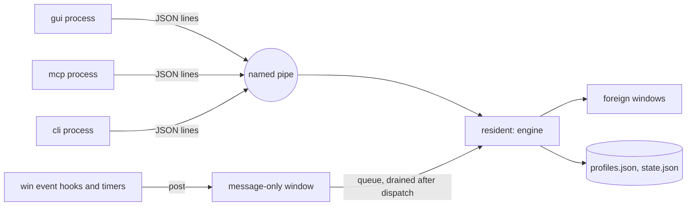

# Architecture

Borderless Shatter (0.2.0) is one Windows executable, `borderless-shatter.exe`, that makes game windows
borderless and places them in "islands" (rectangles on a monitor). It is a single Rust crate (library plus
binary) with no runtime other than the OS.

## Processes

One binary, four roles, chosen by the first argument (`src/main.rs`):

| Role | Started by | What it does |
|---|---|---|
| **Resident** (no arguments) | the user, the GUI or the MCP server | Owns every managed window's state. Tray icon, message loop, window watcher, IPC server. |
| **GUI** (`gui`) | tray menu or command line | GPUI app in its own process. A thin client: it holds no window state and talks to the resident over the pipe. |
| **MCP** (`mcp`) | an MCP client, over stdio | One tool per IPC method, forwarded unchanged. Starts a resident only when the pipe does not exist. |
| **CLI** (any other subcommand) | the user | Same IPC methods, JSON on stdout. Exit codes: 0 ok, 1 resident error, 2 usage, 3 resident unreachable. Never starts a resident. |

Only the resident changes foreign windows, so there is one place where a restore can be guaranteed. A second
resident is refused by a per-user mutex (`Local\BorderlessShatter.SingleInstance`, `src/win32/mod.rs`).
`BORDERLESS_SHATTER_INSTANCE=<suffix>` gives an isolated instance (own mutex, pipe and `state.<suffix>.json`); a set but invalid value (not `[A-Za-z0-9-]{1,32}`, or not Unicode; empty counts as unset) is refused: resident, GUI and MCP exit with `fatal:` and code 1, the CLI exits with code 2 (`cli.error.invalid_instance`), never falling back to the real instance.
The tests use it.

## Module map

| Module | Role |
|---|---|
| `main.rs` | Dispatch by subcommand; no logic. |
| `tray.rs` | Resident entry (`run`): single-instance mutex, tray icon and menu, the message loop, tooltip status (at most 127 UTF-16 units). |
| `engine.rs` | Single-threaded owner of managed-window state: captures, applies, restores, plans targets (request beats profile), re-adopts after a crash, answers IPC requests. |
| `window_state.rs` | Pure style masks and rect math. |
| `guard.rs` | Pure state machine (injected clock) for re-assertions and `fights_back`. |
| `islands.rs` | Layouts and islands to physical rects (edges rounded, not sizes); monitor resolution. |
| `profiles.rs` | Serde model v2 (layouts, islands, `game_resolution`), v1 migration, validation, atomic save, `revision`. |
| `settings.rs` | `settings.json` (language). |
| `state_store.rs` | `state.json`: what the engine needs to restore windows after an abrupt exit. |
| `diagnose.rs` | Applies and samples a window to measure whether the game reverts the change. |
| `watcher.rs` | `SetWinEventHook`; the callback filters and posts. |
| `ipc/` | Protocol types and framing (`mod.rs`); named-pipe server and client (`pipe.rs`). |
| `mcp.rs`, `cli.rs` | The two non-GUI clients of the pipe. |
| `gui/` | GPUI views; pure geometry in `editor_model.rs` and `monitor_preview.rs`. |
| `i18n.rs`, `locales/` | Message catalogs (`en`, `es`). |
| `win32/` | Thin wrappers over the `windows` crate with `Win32Error`; `OwnedHandle` is RAII. |

`tests/` holds the integration suites (`cli`, `mcp`, `i18n`, `properties`, `e2e`); `examples/testwin.rs` is
the fake game window the e2e tests drive.

## Event loop

The resident thread runs `GetMessageW` / `DispatchMessageW` on a message-only window (`HWND_MESSAGE`,
`tray::run`). After every dispatched message it calls `Engine::drain`, then drains tray commands, menu
rebuilds and status updates.

**The window procedure only queues.** `engine::wnd_proc` turns a message into an `Event` pushed onto a
thread-local queue; `Engine::drain` does the work. Reason: the procedure can run nested inside the tray
menu's modal loop, and doing foreign-window Win32 calls there would re-enter the engine. Queueing gives
one known place with exclusive access to the engine. For the same reason the win event hook callback
(`watcher.rs`) only filters and posts, and IPC requests reach the engine through a channel plus a posted
message (`ipc_handler` in `tray.rs`). Delays (apply delay, settle, re-assert) are timers, not sleeps.

## IPC

- **Pipe**: `\\.\pipe\BorderlessShatter-<SID>[-<suffix>]`, with the instance suffix when set (`pipe_name_for`,
  `src/ipc/pipe.rs`). The DACL is `D:P(A;;GA;;;<user SID>)`, a protected ACL for the current user only;
  remote clients are rejected, and the server's first instance uses `first_pipe_instance`, so a squatted
  pipe name is a hard error.
- **Framing**: one JSON object per line, at most `MAX_LINE` (1 MiB). Methods and payloads live in
  `ipc/mod.rs`; `hello` returns `PROTOCOL` (2) and clients refuse a different value.
- **Errors**: `ErrorBody { code, message }`. Clients match `code`, never the English message; transport
  failures carry `os error N` instead of the localized OS text.
- **Timeouts**: a client waits at most 70 s for one reply (`READ_TIMEOUT` = `max(MAX_DELAY_MS + PENDING_GRACE_MS, MAX_OBSERVE_MS)` + 6 s), which only bounds a resident
  stalled in a modal tray menu. `diagnose` observes up to 15 s (`MAX_OBSERVE_MS`).
- **Starting the resident**: the MCP server starts one only on `NotRunning` (pipe absent); a busy or foreign
  pipe is reported, and parallel calls start it once (`mcp.rs`, `call_resident`). The GUI probes with
  `hello`.

## Data files

All in `BorderlessShatter\` under the user profile. Every write goes through `write_atomic` (`src/lib.rs`):
write `<file>.tmp`, `sync_all`, then rename, so a reader or a power cut sees the old file or the new one.

| File | Location | Safety rules |
|---|---|---|
| `profiles.json` | `%APPDATA%` | Version 2, shared by all instances. Saved atomically; the replaced file is kept as `profiles.json.prev` (best effort). A v1 file is first copied to `profiles.v1.bak`, once. `revision` is the SHA-256 of the bytes; `set_profiles` with a stale `expected_revision` fails with `revision_conflict`. Invalid JSON is never overwritten. Unknown fields are kept. UTF-8 BOM accepted; UTF-16 refused with an error. |
| `settings.json` | `%APPDATA%` | Version 1, at most 64 KiB, BOM accepted, unknown fields kept, atomic save. |
| `state.json` | `%LOCALAPPDATA%` | `state.<suffix>.json` for an isolated instance. Saved on every change of the managed set. A file that cannot be read is kept and moved to `state.json.bad` before the next save (replacing an older `.bad`); while the move fails nothing is written. |

## Invariants

- The resident owns restore state; clients never touch foreign windows (`engine.rs`).
- Applying captures style, extended style, rect and maximized state first; restoring sets styles, then the
  rect with `SWP_RESTORE` (`0x34`), then re-maximizes (`restore_window`). A restore is never skipped because
  the window "already looks right".
- State is persisted before a restore touches the window (`persist` in `restore_window`) and re-adopted at
  startup only for windows whose handle still exists with the same pid (`readopt`), so a reused handle is
  never given a dead window's state. A restore of a closed window reports `window_not_found`.
- `shutdown` restores every managed window when the loop ends (`Engine::shutdown`).
- Foreign-window calls happen only on the resident thread, inside `Engine::drain` (see Event loop).
- `window_state.rs`, `guard.rs` and `islands.rs` import no `windows` types; they are unit-tested without a
  desktop.
- Every `unsafe` block has a `// SAFETY:` comment; no `unwrap`/`expect` outside tests.
- The pipe is per user with a protected DACL; the protocol and MCP tool texts are English only.
- The editor saves with the `revision` it read, so a concurrent change is a `revision_conflict`, never a silent overwrite.
