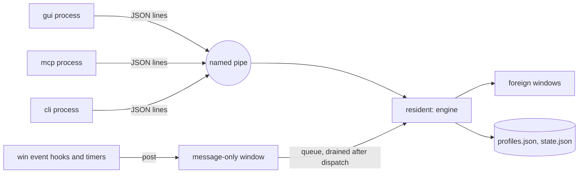

# Architecture

Borderless Shatter is one Windows executable, `borderless-shatter.exe`, that makes game windows
borderless and places them in "islands" (rectangles on a monitor). It is a single Rust crate (library plus
binary) with no runtime other than the OS.

## Processes

One binary, four roles, chosen by the first argument (`src/main.rs`):

| Role | Started by | What it does |
|---|---|---|
| **Resident** (no arguments) | the user, the GUI or the MCP server | Owns every managed window's state. Tray icon, message loop, window watcher, IPC server. |
| **GUI** (`gui`) | tray menu or command line | GPUI app in its own process. A thin client: it holds no window state and talks to the resident over the pipe. |
| **MCP** (`mcp`) | an MCP client, over stdio | One tool per IPC method, forwarded unchanged. Starts a resident only when the pipe does not exist. |
| **CLI** (any other subcommand) | the user | Same IPC methods, JSON on stdout. Exit codes: 0 ok, 1 resident error, 2 usage, 3 resident unreachable. Never starts a resident. |

Only the resident changes foreign windows, so there is one place where a restore can be guaranteed. A second
resident is refused by a per-user mutex (`Local\BorderlessShatter.SingleInstance`, `src/win32/mod.rs`).
`BORDERLESS_SHATTER_INSTANCE=<suffix>` gives an isolated instance (own mutex, pipe and `state.<suffix>.json`); a set but invalid value (not `[A-Za-z0-9-]{1,32}`, or not Unicode; empty counts as unset) is refused: resident, GUI and MCP exit with `fatal:` and code 1, the CLI exits with code 2 (`cli.error.invalid_instance`), never falling back to the real instance.
The tests use it.

## Module map

| Module | Role |
|---|---|
| `main.rs` | Dispatch by subcommand; no logic. |
| `tray.rs` | Resident entry (`run`): single-instance mutex, tray icon and menu, the message loop, tooltip status (at most 127 UTF-16 units). |
| `engine.rs` | Single-threaded owner of managed-window state: captures, applies, restores, plans targets (request beats profile), re-adopts after a crash, answers IPC requests. |
| `window_state.rs` | Pure style masks and rect math. |
| `guard.rs` | Pure state machine (injected clock) for re-assertions and `fights_back`. |
| `islands.rs` | Layouts and islands to physical rects (edges rounded, not sizes); monitor resolution. |
| `profiles.rs` | Serde model v2 (layouts, islands, `game_resolution`), v1 migration, validation, atomic save, `revision`. |
| `settings.rs` | `settings.json` (language). |
| `state_store.rs` | `state.json`: what the engine needs to restore windows after an abrupt exit. |
| `diagnose.rs` | Applies and samples a window to measure whether the game reverts the change. |
| `watcher.rs` | `SetWinEventHook`; the callback filters and posts. |
| `ipc/` | Protocol types and framing (`mod.rs`); named-pipe server and client (`pipe.rs`). |
| `mcp.rs`, `cli.rs` | The two non-GUI clients of the pipe. |
| `gui/` | GPUI views; pure geometry in `editor_model.rs` and `monitor_preview.rs`. |
| `i18n.rs`, `locales/` | Message catalogs (`en`, `es`). |
| `win32/` | Thin wrappers over the `windows` crate with `Win32Error`; `OwnedHandle` is RAII. |

`tests/` holds the integration suites (`cli`, `mcp`, `i18n`, `properties`, `e2e`); `examples/testwin.rs` is
the fake game window the e2e tests drive.

## Event loop

The resident thread runs `GetMessageW` / `DispatchMessageW` on a message-only window (`HWND_MESSAGE`,
`tray::run`). After every dispatched message it calls `Engine::drain`, then drains tray commands, menu
rebuilds and status updates.

**The window procedure only queues.** `engine::wnd_proc` turns a message into an `Event` pushed onto a
thread-local queue; `Engine::drain` does the work. Reason: the procedure can run nested inside the tray
menu's modal loop, and doing foreign-window Win32 calls there would re-enter the engine. Queueing gives
one known place with exclusive access to the engine. For the same reason the win event hook callback
(`watcher.rs`) only filters and posts, and IPC requests reach the engine through a channel plus a posted
message (`ipc_handler` in `tray.rs`). Delays (apply delay, settle, re-assert) are timers, not sleeps.

## IPC

- **Pipe**: `\\.\pipe\BorderlessShatter-<SID>[-<suffix>]`, with the instance suffix when set (`pipe_name_for`,
  `src/ipc/pipe.rs`). The DACL is `D:P(A;;GA;;;<user SID>)`, a protected ACL for the current user only;
  remote clients are rejected, and the server's first instance uses `first_pipe_instance`, so a squatted
  pipe name is a hard error.
- **Framing**: one JSON object per line, with unique keys at every level, at most `MAX_LINE` (1 MiB). Methods and payloads live in
  `ipc/mod.rs`; `hello` returns `PROTOCOL` (2) and clients refuse a different value.
- **Errors**: `ErrorBody { code, message }`. Clients match `code`, never the English message; transport
  failures carry `os error N` instead of the localized OS text.
- **Timeouts**: a client waits at most 70 s for one reply (`READ_TIMEOUT` = `max(MAX_DELAY_MS + PENDING_GRACE_MS, MAX_OBSERVE_MS)` + 6 s), which only bounds a resident
  stalled in a modal tray menu. `diagnose` observes up to 15 s (`MAX_OBSERVE_MS`).
- **Starting the resident**: the MCP server starts one only on `NotRunning` (pipe absent); a busy or foreign
  pipe is reported, and parallel calls start it once (`mcp.rs`, `call_resident`). The GUI probes with
  `hello`.

## IPC protocol

Reference for every client. All coordinates are physical pixels; hexadecimal styles are strings (`"0x94000000"`).

**Envelope.** Request `{"id", "method", "params"?}`; response `{"id", "result"}` or `{"id", "error": {"code", "message", "data"?}}`. `id` is an integer or a string chosen by the client and returned unchanged. Several requests may be in flight; the engine serializes them. There are no server notifications: clients poll.

**Common types.** `WindowRef` is `{"hwnd": n}` or `{"process": "game.exe", "title"?: "text"}` (`title` is a case-insensitive substring; several matches fail with `ambiguous_window` and `data.candidates`; `hwnd` is not stable across game runs). `Rect` is `{left, top, right, bottom}`. An island is referred to as `"layout/island"`. A monitor is an index, a device name (`\\.\DISPLAY1`) or `"primary"`.

**Strict decoding.** Applies to every request line and to MCP tool arguments.

- A key repeated in any object of the line (envelope, `params`, nested at any depth, unknown fields included) is `invalid_params`. Keys are compared after JSON escapes are decoded. The response `id` is `0` when the repeated key is the top-level `id`; otherwise it is the request's `id`. A syntax error takes precedence: a broken line is `invalid_json`.
- An array where the schema expects an object (`window`, `offsets`, `game_resolution`, `rect`, and any other struct at any depth) is `invalid_params`. Arrays are accepted only where the method table shows a list (`remove`, `remove_layouts`, `profiles`, `layouts`, `islands`) and inside unknown or extra fields. `null` is accepted only where the field is nullable (`offsets`, `monitor`, `game_resolution`, `island`, `delay_ms`, `hwnd`, `process`, `title`, `profiles`, `layouts`, `remove`, `expected_revision`); elsewhere (`use_profile`, `observe_ms`, `keep`, `include_hidden`, `remove_layouts`, `replace_extras`, …) it is `invalid_params`. A whole `params` of `null` or absent means `{}`.
- Unknown fields are still ignored. Every method, including `hello`, `restore_all`, `list_islands` and `get_profiles`, validates `params` this way: a non-object `params` is `invalid_params`.
- Over MCP, the array rule is a tool error (`isError: true`, `failed to deserialize parameters: …`) and the call never reaches the resident. Repeated keys are not detected over MCP: rmcp collapses them before the tool sees `arguments`.
- Responses are produced only by the engine, and clients decode them without this rigidity.

**Methods.** The MCP tools are these methods, same names and shapes, except `hello`.

| Method | Params | Result |
|---|---|---|
| `hello` | none | `{protocol, version, pid, profiles_revision}`. Clients call it first and refuse a different `protocol`. |
| `list_windows` | `{process?, include_hidden?, only_managed?}` | `{windows: [{hwnd, pid, process, title, class, visible, style, exstyle, rect, client: {w, h}, monitor: {index, device}, dpi, dpi_awareness, elevated, maximized, minimized, managed, island?}]}`. `dpi_awareness` is `unaware`, `system`, `per_monitor`, `per_monitor_v2` or `unknown`; `elevated` may be `null`. |
| `apply` | `{window, island?, monitor?, offsets?, delay_ms?, use_profile?=true}` | `{applied, reason?, hwnd, target, final, settled, warnings}`. Request fields beat the process profile; without either, the window's current monitor is used. `applied: false` carries `reason` `already_placed` or `excluded`. Replies after the settle window, up to `delay_ms` + `PENDING_GRACE_MS` later. |
| `place` | `{window, island, game_resolution?: {width, height}}` | Same as `apply`, without needing a saved profile. |
| `restore` | `{window}` | `{restored, exact, hwnd}`. `exact` means style, ex-style and rect read back equal the originals; `restored: false` for a window that was not managed. |
| `restore_all` | none | `{restored: n, failed: [{hwnd, error}]}`; tries every window even when some fail. |
| `list_islands` | none | `{monitors: [{index, device, rect, dpi, primary}], layouts: [{id, monitor, islands: [{id, rect, occupants: [hwnd]}]}]}`, rects resolved. |
| `get_profiles` | none | `{path, revision, version, profiles, layouts, warnings}`. `revision` is the SHA-256 of the file bytes. |
| `set_profiles` | `{profiles?, layouts?, remove?: [process], remove_layouts?: [id], expected_revision?}` | `{revision, warnings}`. Upserts by `process` / layout `id`, removes, validates, saves atomically. A stale `expected_revision` fails with `revision_conflict`. |
| `diagnose` | `{window, island?, monitor?, observe_ms?=3000, keep?=false}` | `{hwnd, process, target, verdict, timeline: [{t_ms, source, op?, style, exstyle, rect}], final, forced_size?, revert_latency_ms: {style?, rect?}, dpi_awareness, recommendations: [{code, text, data?}], restored}`. Applies, samples, and restores unless `keep`. `source` is `us` or `window`; `verdict` is `accepted`, `style_reverted`, `size_forced`, `position_forced`, `style_and_size_reverted` or `late_revert`. `observe_ms` is clamped to 100–`MAX_OBSERVE_MS`, not rejected. |

**Precedence.** Request parameters beat profile fields; inside a profile, `island` beats `monitor` and `offsets` (`set_profiles` rejects the combination with `island_overrides_monitor`). A profile's `game_resolution` places the window at that size centred in the island, clipped (with `game_resolution_exceeds_island`) if larger.

**Warnings** (`{code, data}`, on `apply`/`place`): `size_forced`, `position_forced`, `style_reverted` (what was observed in the settle window), `game_resolution_exceeds_island`, and `fights_back` once the guard gave up. `get_profiles` and `set_profiles` warnings are validation codes: `island_overrides_monitor`, `bad_island_ref`, `island_not_found` (informational), `bad_game_resolution`, and for layouts `bad_layout_id`, `duplicate_layout`, `bad_island_id`, `duplicate_island`, `bad_island_rect`. All but `island_not_found` block the write; a rejected write is `profile_error` with `data.warnings`, and only warnings about what the call itself wrote count.

**Error codes.** `error.code` is stable; `message` is English and not part of the contract; `data` is optional.

| `code` | When |
|---|---|
| `invalid_params`, `unknown_method`, `invalid_json` | Malformed request, unknown method, bad JSON or a line over `MAX_LINE`. `invalid_params` also covers `delay_ms` above `MAX_DELAY_MS`, a repeated object key, or an array where an object is expected. |
| `window_not_found`, `ambiguous_window`, `window_gone` | No match (or not a visible top-level window), several matches, or the window vanished mid-operation. |
| `access_denied` | The window is elevated and the resident is not; `data.elevated: true`. |
| `excluded_process` | `diagnose` on a process of the fixed exclusion list (`apply` reports it as `applied: false`, `reason: "excluded"`). |
| `island_not_found`, `monitor_unavailable` | The island or monitor does not exist; never a fallback. |
| `profile_error`, `revision_conflict`, `unsupported_version` | Loading, validating or saving `profiles.json`; a newer file `version`. |
| `win32_error` | A call failed: `data.call`, `data.code` (Win32 code) and `data.hresult`; the message says `os error N`, never the system text. |
| `busy` | An operation on that window is already running, or it is managed and `diagnose` was asked. |
| `internal` | Unexpected failure. |

**Limits.**

| Constant | Value | Meaning |
|---|---|---|
| `PROTOCOL` | 2 | Returned by `hello`. |
| `MAX_LINE` | 1 MiB | Longest JSON line; a longer one is drained to its newline and answered with `invalid_json`. |
| `MAX_DELAY_MS` | 60 000 | Largest `delay_ms`, from a request or a profile. |
| `MAX_OBSERVE_MS` | 15 000 | Largest `diagnose` observation. |
| `PENDING_GRACE_MS` | 4 000 | How long an `apply` reply may wait past its delay. |
| client deadline | 70 s | `max(MAX_DELAY_MS + PENDING_GRACE_MS, MAX_OBSERVE_MS)` + 6 s (`READ_TIMEOUT`). A client that times out cannot know whether its request ran: read the state again before retrying. |

**Messages are English only.** Protocol messages, recommendation `text` and MCP tool descriptions are English; the panel localizes from `code` and `data`. MCP reports an IPC error, or malformed tool arguments, as a tool result with `isError: true`; an unknown tool name is JSON-RPC `-32602`. A tool result carries `started_resident: true` only when that call started the resident.

## Data files

All in `BorderlessShatter\` under the user profile. Every write goes through `write_atomic` (`src/lib.rs`):
write `<file>.tmp`, `sync_all`, then rename, so a reader or a power cut sees the old file or the new one.

| File | Location | Safety rules |
|---|---|---|
| `profiles.json` | `%APPDATA%` | Version 2, shared by all instances. Saved atomically; the replaced file is kept as `profiles.json.prev` (best effort). A v1 file is first copied to `profiles.v1.bak`, once. `revision` is the SHA-256 of the bytes; `set_profiles` with a stale `expected_revision` fails with `revision_conflict`. Invalid JSON is never overwritten. Unknown fields are kept at file, profile, layout and island level (not inside `rect`, `offsets`, `game_resolution` or `monitor`); a `set_profiles` replacement keeps the old unknown fields of a profile, layout or island unless the new item brings its own (islands matched by `id`), and `replace_extras: true` stores each sent item exactly as sent. UTF-8 BOM accepted; UTF-16 refused with an error. |
| `settings.json` | `%APPDATA%` | Version 1, at most 64 KiB, BOM accepted, unknown fields kept, atomic save. |
| `state.json` | `%LOCALAPPDATA%` | `state.<suffix>.json` for an isolated instance. Saved on every change of the managed set. A file that cannot be read is kept and moved to `state.json.bad` before the next save (replacing an older `.bad`); while the move fails nothing is written. |

## Invariants

- The resident owns restore state; clients never touch foreign windows (`engine.rs`).
- Applying captures style, extended style, rect and maximized state first; restoring sets styles, then the
  rect with `SWP_RESTORE` (`0x34`), then re-maximizes (`restore_window`). A restore is never skipped because
  the window "already looks right".
- State is persisted before a restore touches the window (`persist` in `restore_window`) and re-adopted at
  startup only for windows whose handle still exists with the same pid (`readopt`), so a reused handle is
  never given a dead window's state. A restore of a closed window reports `window_not_found`.
- `shutdown` restores every managed window when the loop ends (`Engine::shutdown`).
- Foreign-window calls happen only on the resident thread, inside `Engine::drain` (see Event loop).
- `window_state.rs`, `guard.rs` and `islands.rs` import no `windows` types; they are unit-tested without a
  desktop.
- Every `unsafe` block has a `// SAFETY:` comment; no `unwrap`/`expect` outside tests.
- The pipe is per user with a protected DACL; the protocol and MCP tool texts are English only.
- The editor saves with the `revision` it read, so a concurrent change is a `revision_conflict`, never a silent overwrite. After a `revision_conflict` the profile form reloads and merges field by field (base = the saved profile it was opened on, mine = the typed form, theirs = the reloaded profile): one-sided changes are taken automatically, a field changed on both sides to different values is marked and keeps the typed value until the user picks one, and the form saves with the new revision only when no field is marked. Cancel discards the merge.

## Design constraints

Things the code or its contributors depend on, with the reason in one line each.

- **One owner of restore state.** The original style, ex-style, rect and maximized flag live only in the resident's memory; a client that changed windows itself would leave them frameless when it exits.
- **Placement, not reparenting.** Islands place a borderless top-level window in a rectangle; a `SetParent` container would put input and focus at risk and make the exact restore unreliable.
- **Win event hooks, not polling.** They cost no CPU at rest, need no injection or administrator rights, and still see a game that puts its frame back later.
- **Events and timers go to a message-only window.** Thread messages are lost while the tray menu runs its modal loop; the apply delay is a `SetTimer`, never a sleep.
- **Style masks.** Applying clears `0x00CF0000` from the style and `0x020E0381` from the ex-style, writes the styles first and the rect second, and always passes `SWP_FRAMECHANGED`; skipping the flag was never shown to be safe. The masks are observed facts about Win32, not code taken from another project.
- **The guard decides by the target rect, not by frame bits.** A game that already has no frame (Unity with `-popupwindow`, style `0x94000000`) still needs placing, and a frame-bit test would skip it.
- **Guard tuning comes from measured games.** Settle 600 ms (three times the slowest observed revert), at most 3 re-asserts per cycle after 50/150/400 ms (re-asserting right after a revert only provokes another), stop when the same forced rect repeats, at most 3 cycles per minute; after that the window is marked `fights_back` and left alone until an explicit `apply`.
- **Not elevated.** The manifest is `asInvoker`; UIPI makes writes to elevated windows fail, reported as `access_denied` with `data.elevated: true`.
- **The manifest is embedded by `gpui-pre`.** A second one (`build.rs`, `app.rc`, `app.manifest`) collides with it at link time (`CVT1100`); if the GUI is ever split into its own binary, the resident one needs its own manifest back.
- **Physical pixels everywhere.** Engine, pipe and profile coordinates are physical because the process is PerMonitorV2; a DPI-unaware game is sized in its own virtual pixels (`dpi/96`), which is why `list_windows` reports `dpi` and `dpi_awareness`.
- **Islands round edges, not sizes.** `left = L + round(x·W)`, `right = L + round((x+w)·W)`, so adjacent islands share an edge with no gap or overlap at any width.
- **A missing monitor is an error, never a fallback.** `monitor_unavailable` guarantees a game is not placed on the wrong screen; `list_islands` skips layouts whose monitor is gone.
- **Several windows may share an island.** There is no eviction; a closed window's entry is dropped.
- **Legacy preset ids are aliases.** `mitades-16-9`, `izquierda` and `derecha` resolve to `halves-16-9`, `left` and `right` (`LEGACY_ALIASES`), and `profiles.json` is never rewritten to the new names, so users who go back to an older build lose nothing.
- **`profiles.json` is never destroyed.** Invalid JSON and a newer `version` are reported and left on disk; unknown fields are kept; a v1 file is read as v2 and only becomes v2 on disk when `set_profiles` or the panel saves, after a one-time `profiles.v1.bak`.
- **`clip_cursor` is accepted and ignored.** Old profiles that carry it keep loading.
- **Engine, IPC and MCP texts are English only.** Windows localizes OS error text, so messages carry `os error N` or `HRESULT 0x…` instead; clients match `code` and the panel renders its own sentence from `code` and `data`. Only the panel and the tray use the `es` catalog (fallback `es` → `en` → key).
- **Locale order.** `BORDERLESS_SHATTER_LANG`, then the `language` setting, then the Windows UI language; the tray picks it up at the next resident start.
- **MCP starts the resident, the CLI never does.** An assistant that calls `apply` without the app running cannot fix that itself, while a script that wants a failure should get exit code 3.
- **`testwin` stands in for hostile games.** Real games cannot be made to revert a style or force a size on demand, so `examples/testwin.rs` imitates them; its timings differ slightly from the real ones (see `docs/GAMES.md`).
