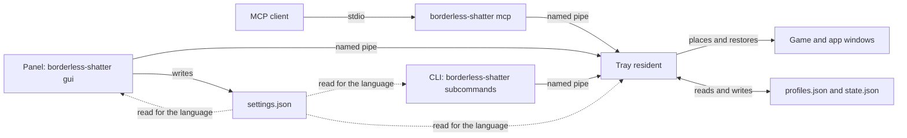

# Shattered Islands
<p align="center"><picture><source media="(prefers-color-scheme: dark)" srcset="docs/banner-dark.svg"></picture></p>
<p align="center"><a href="https://github.com/frandev94/shattered-islands/releases"></a> <a href="LICENSE"></a> <a href="#requirements-and-build"></a> <a href="#requirements-and-build"></a></p>

Free MIT alternative to Borderless Gaming — borderless windows and screen islands for Windows

Until the [rename](https://github.com/frandev94/shattered-islands/issues/13) lands, the executable `borderless-shatter.exe`, the data folders `%APPDATA%\BorderlessShatter\` and `%LOCALAPPDATA%\BorderlessShatter\`, the named pipe and the MCP server still use `borderless-shatter` / `BorderlessShatter`, and the tray tooltip and the panel title still read "Borderless Shatter".

## What it does

- Runs in the tray: double-click the icon to open the panel, right-click for the menu.
- Panel views: Windows, Islands, Island editor, Profiles and Diagnostics.
- Fits windows to the monitor or to an *island*: a named rectangle of a monitor (for example, one half of a 32:9 screen). The read-only `halves-16-9` preset ships built in.
- Removes the frame (title bar, borders, buttons) from the windows of processes that have a profile, handles windows that already have no frame, and keeps a guard that re-asserts the placement a limited number of times against games that fight back.
- Restores the window exactly as it was (style, position, size, maximized state) when requested and on exit; after an abrupt shutdown it re-adopts the modified windows from `state.json`.
- Detects new windows through Windows events, without polling.
- Offers an MCP server (9 tools) and a command-line client, both clients of the same named pipe. The MCP server can start the resident program; the CLI cannot.
- Single instance: a second run does not create another icon.
- English and Spanish. Does not need administrator permissions.

### How it fits together



## Status

An earlier build, before islands and the panel, was tested on 2026-11-25 on one 5120x1440 physical monitor at 125% scale:

- Notepad: applies and restores exactly; with a 1500 ms delay, 5 of 5 exact.
- Test window `testwin`, 12 scenarios (immediate and with a 1500 ms delay): exact restore in all of them.
- Total War: WARHAMMER III: the game reverts the changes (see [Known limitations](#known-limitations)); the restore is exact.

Not tested: multiple monitors, windows of elevated processes, Phoenix Wright: Ace Attorney Trilogy.

Per-game details in [`docs/GAMES.md`](docs/GAMES.md).

## Requirements and build

- Windows 10/11 x64.
- Stable Rust with the MSVC toolchain.

```
cargo build --release
```

The executable ends up in `target\release\borderless-shatter.exe`. It weighs about 18 MB because of the GUI. A clean release build takes about 5 min and a debug build about 1.5 min (GPUI).

Use the release build for everyday work: it is a Windows-subsystem program. The debug build is a console program and opens a console window.

The Windows manifest (asInvoker, PerMonitorV2, Common Controls and SegmentHeap) is provided by `gpui-pre` through `gpui-kit`; the project has no `build.rs` or `app.manifest` of its own, because a second one collides with the embedded resource at link time.

Tests: `cargo test` runs the unit, property and doc tests. The suites that open real windows are ignored by default; see [`CONTRIBUTING.md`](CONTRIBUTING.md) and the "Testing & QA" section of [`AGENTS.md`](AGENTS.md).

## Usage

1. Run `borderless-shatter.exe`. The icon appears in the tray.
2. Double-click the icon, or choose "Open panel", to open the panel (the subcommand `borderless-shatter gui`, a separate process that talks to the resident process through the named pipe). A left click on the icon does nothing; a right click opens the menu.
3. Create or edit profiles in the panel, or in [`profiles.json`](#profiles) followed by "Reload profiles".
4. When a window of a process with a profile opens, its frame is removed and it is fitted to its monitor or island.

If the resident that is running comes from another version (a different IPC protocol), the panel says so in the sidebar and sends it no request until you restart it, the same way the CLI and the MCP server refuse it.

Tray menu:

| Action | Effect |
|---|---|
| `Open panel` | Opens the panel |
| `Apply: <process>` (one per process) | Applies the profiles to that process's windows now: each window gets its best match among that process's profiles (see [Window title rules](#window-title-rules)); a window whose best match is disabled is left alone |
| `Place active window in island` | Submenu with one entry per `layout/island` |
| `Restore all` | Returns all windows to their original state |
| `Reload profiles` | Re-reads `profiles.json` and rebuilds the menu |
| `Quit` | Restores the windows and closes the program |

A window restored from the tray is not automatically handled again.

Panel views:

- **Windows**: lists the open windows with their managed state (and the island or "fights back" flag), with search, "Managed only" and "Show all" filters, and "Restore all".
- **Islands**: shows the monitors and their islands to scale, with the window that occupies each one.
- **Island editor**: creates and edits layouts and islands by dragging, snapping or typing values. The built-in preset is read-only: "Duplicate to edit" makes an editable copy.
- **Profiles**: edits the per-game profiles (window rule, island, game resolution, delay, enabled). Under the process, "Window" chooses which of its windows the profile takes: "Any window", "Exact title" (ignores case and spaces at the start and end) or "Title (regex)" (searched anywhere in the title; `^…$` for the whole title); a regular expression that does not compile is flagged inline. The list shows the rule under the process and orders each process's profiles by precedence (exact title, regex, any window), then file order; search also looks at the rule. The process and the rule of an existing profile cannot be changed: create another profile and remove the old one. A profile with both `title` and `title_regex` (edited by hand) can only be deleted from its form. If the profile changes outside the panel while you edit it, your typed values are kept: fields you did not touch take the saved version, and a field changed on both sides shows the outside value until you choose (an island and the offsets or monitor, or width and height, count as one field when they clash). Choose "Keep mine and overwrite" to save your value with the new revision, or "Use the outside values" to replace only the marked fields. Cancel discards everything.
- **Diagnostics**: applies a profile to a window and measures how the game reverts the style and the size, with a verdict and recommendations.

Language: the panel has a language selector (System, English, Spanish). The choice is stored in `settings.json`. The language is picked in this order: the `BORDERLESS_SHATTER_LANG` environment variable (`en` or `es`), then `settings.json`, then the Windows display language (Spanish if it is Spanish, English otherwise). The tray menu picks the new language the next time the program starts. MCP tool descriptions and the engine's error messages are always English.

Start at sign-in: a "Start at sign-in" switch in the panel (next to the language selector) and a checkable item in the tray menu start the tray at Windows sign-in. It is off by default, needs no administrator rights, and writes one per-user entry under `HKCU\Software\Microsoft\Windows\CurrentVersion\Run` only when you turn it on; turning it off removes it. The registry is the only record (nothing is stored in `settings.json`), so the panel and the tray always show what Windows has. If the entry points to another copy of the program, the panel says which one; turning it on again makes it start this copy. If you disabled it in Task Manager's Startup tab, the panel says so; turning it on here re-enables it. An instance started with `BORDERLESS_SHATTER_INSTANCE` uses its own entry name.

## Profiles

File: `%APPDATA%\BorderlessShatter\profiles.json`. If it does not exist, it is created empty at startup. The format version is `2`; a higher version is rejected and the file is left untouched. A version `1` file is read as is and migrated on the next save; the original is first copied once to `profiles.v1.bak`. Every save also keeps the replaced file as `profiles.json.prev`. An invalid file is reported and never overwritten.

A key repeated in any object, or an array where an object is expected (`offsets`, `game_resolution`, `rect`), makes the file invalid, as for requests. The error names the repeated key (`duplicate key "_note"`) or the JSON path (`/profiles/0/offsets`), and the file is never overwritten. A version higher than `2` is reported as an unsupported version even if the file also repeats a key or uses an array where an object is expected; syntax and type errors are still reported first.

```json
{
  "version": 2,
  "layouts": [
    {
      "id": "ultrawide-thirds",
      "monitor": "primary",
      "islands": [
        { "id": "left", "rect": { "x": 0.0, "y": 0.0, "w": 0.5, "h": 1.0 } },
        { "id": "right-px", "rect": { "unit": "px", "x": 2560, "y": 0, "w": 2560, "h": 1440 } }
      ]
    }
  ],
  "profiles": [
    {
      "process": "Warhammer3.exe",
      "enabled": true,
      "island": "halves-16-9/left",
      "game_resolution": { "width": 2048, "height": 1152 },
      "delay_ms": 0
    },
    {
      "process": "notepad.exe",
      "monitor": "current",
      "offsets": { "left": 0, "top": 0, "right": 0, "bottom": 0 }
    },
    {
      "process": "Game.exe",
      "title_regex": "^Game - Level \\d+$",
      "island": "halves-16-9/right"
    },
    {
      "process": "Game.exe",
      "title": "Game Launcher",
      "enabled": false
    }
  ]
}
```

| Field | Type | Default | Description |
|---|---|---|---|
| `version` | number | required | Format version (`1` or `2`) |
| `layouts` | list | empty | Your layouts, merged over the built-in presets |
| `profiles` | list | empty | Profiles |
| `process` | text | required | Executable name |
| `title` | text | none | Only windows whose title is exactly this text, ignoring case and spaces at the start and end. Cannot be combined with `title_regex` |
| `title_regex` | text | none | Only windows whose title matches this regular expression ([`regex`](https://docs.rs/regex) syntax, linear time). It is searched anywhere in the title: use `^…$` for the whole title and `(?i)` to ignore case. A pattern over 1 MiB compiled (for example `\w{50}`) is rejected like one that does not compile. Cannot be combined with `title` |
| `enabled` | boolean | `true` | If `false`, the profile is not applied |
| `island` | text | none | `"layout/island"`; overrides `monitor` and `offsets` |
| `game_resolution` | `{width, height}` | none | Declared game resolution in physical pixels; the window is centred in the island |
| `monitor` | `"current"` or number | `"current"` | Current monitor of the window, or monitor index (integer ≥ 0); ignored when `island` is set |
| `offsets` | object | all `0` | `left` and `top` shift the origin; `right` and `bottom` adjust the width and height: `width = monitor − left + right`, `height = monitor − top + bottom`. Each omitted key is `0`; ignored when `island` is set |
| `delay_ms` | number | `0` | Wait in milliseconds before applying (at most 60000) |
| `clip_cursor` | boolean | `false` | Accepted and ignored |

Fields the program does not know are kept when the file is saved, at the file level and inside each profile, layout and island (not inside `rect`, `offsets`, `game_resolution` or `monitor`). Saving from the panel keeps them. When `set_profiles` replaces a profile, layout or island, it keeps the old unknown fields unless the new item brings its own; islands are matched by `id`. To remove them, send the items without them and `"replace_extras": true`: each sent item is stored exactly as sent, and items not sent are untouched.

An older resident on the same pipe ignores `replace_extras` (it does not reject unknown params), so the call succeeds and keeps the old keys; avoid mixing versions. Duplicating a layout in the editor copies its unknown keys and its islands' keys (intended). Unknown keys at the top level of `profiles.json` cannot be cleared through `set_profiles`; edit the file by hand.

### Window title rules

A process can have several profiles: one without a title rule (any window of the process) plus profiles with `title` or `title_regex`. A profile is identified by its process and its rule, so two profiles with the same process and the same rule are duplicates (`duplicate_profile`; the first one in the file wins).

For a window, the candidates are the profiles of its process whose rule matches its title. The most specific wins: an exact `title`, then a `title_regex`, then the profile without a rule; between equals, the first one in the file. A disabled profile also competes: if it wins, the window is left alone, which is how a launcher window is excluded (the `Game Launcher` profile above). A regular expression that does not compile, an empty rule, or both rules in one profile never match. Excluded system processes stay excluded whatever the rule.

Late titles: a window that is not managed yet is checked when it appears, when it comes to the foreground, and when its title changes. A title change only applies a profile with a title rule, so games that show their frame rate in the title are not re-checked against their process-only profile, and a window that could not be placed is retried when it comes to the foreground again, not on every title change. A managed window keeps the profile it got, whatever its title becomes, until it is restored. If a profile without a rule matches first (for example while the game still shows a loading title), it wins, and a later title does not switch the window to another profile.

`set_profiles` (pipe, MCP, `profiles set`) creates or replaces profiles by process and rule. Its `remove` list takes a process name, which removes only the profile without a title rule of that process, or an object `{"process": "Game.exe", "title": "Game Launcher"}` (or with `title_regex`), which removes that profile; any other field in the object is rejected, so a misspelt rule never removes the profile without a rule:

```json
{ "remove": ["notepad.exe", { "process": "Game.exe", "title_regex": "^Game - Level \\d+$" }] }
```

## Islands

An island is a named rectangle of a monitor. A layout groups the islands of one monitor; an island is referred to as `"layout/island"`.

| Layout field | Description |
|---|---|
| `id` | Layout id |
| `monitor` | `"primary"`, a monitor index, or a device name such as `"\\.\\DISPLAY1"` |
| `islands` | List of `{ "id", "rect" }` |

`rect` is `{ x, y, w, h, unit }`. With `"unit": "fraction"` (the default) the values are fractions of the monitor, `0` to `1`, with at most 6 decimals. With `"unit": "px"` they are physical pixels from the monitor's top-left corner. The edges are rounded, not the sizes, so neighbouring islands never leave a gap.

Built-in preset, read-only (to change it, duplicate it into your own layout; a layout of yours with the same id replaces it):

| Island | Rectangle |
|---|---|
| `halves-16-9/left` | Left half of the primary monitor |
| `halves-16-9/right` | Right half of the primary monitor |

On a 5120x1440 monitor each half is 2560x1440, 16:9. Older ids still work as aliases: `mitades-16-9/izquierda` is `halves-16-9/left` and `mitades-16-9/derecha` is `halves-16-9/right`. Your files are not rewritten because of an alias.

## Data files

| File | Location | Purpose |
|---|---|---|
| `profiles.json` | `%APPDATA%\BorderlessShatter\` | Profiles and layouts (see [Profiles](#profiles)) |
| `profiles.json.prev` | same | The file as it was before the last save |
| `profiles.v1.bak` | same | The original version 1 file, copied once on migration |
| `settings.json` | same | `{ "version": 1, "language": "system" \| "en" \| "es" }`; written only by the panel; an invalid or newer file is ignored and never overwritten |
| `state.json` | `%LOCALAPPDATA%\BorderlessShatter\` | Original state of the managed windows, used to re-adopt them after an abrupt shutdown |
| `state.<suffix>.json` | same | The same, for an isolated instance started with `BORDERLESS_SHATTER_INSTANCE=<suffix>` (1 to 32 characters of `A-Za-z0-9-`; it also gives that instance its own pipe and single-instance lock). An empty value counts as unset. A set but invalid value (other characters, too long, or not Unicode) is refused: the resident, `gui` and `mcp` exit with `fatal:` and code 1, the CLI exits with code 2 and prints `cli.error.invalid_instance`; it never falls back to the real instance |
| `state.json.bad` | same | A state file that could not be read, moved aside so its data is not lost |

## MCP server

`borderless-shatter mcp` serves the Model Context Protocol over stdio: one tool per pipe method (`list_windows`, `apply`, `place`, `restore`, `restore_all`, `list_islands`, `get_profiles`, `set_profiles`, `diagnose`). Results come back as `structuredContent`; a resident error comes back as a tool result with `isError: true` and `code: message`. If the resident is not running, the first tool call starts it, and `_meta` then reports `started_resident`.

Register it in your MCP client with the path of the release executable. For example, in a client's `mcp.json`:

```json
{
  "mcpServers": {
    "borderless-shatter": {
      "type": "stdio",
      "command": "C:\\path\\to\\borderless-shatter.exe",
      "args": ["mcp"]
    }
  }
}
```

Other clients take the same two values: `"command"` and `"args": ["mcp"]`. Prefer the release build; the debug build opens a console window unless the client starts it without one.

## Command line

```
borderless-shatter <subcommand> [options] [--pretty]
```

The subcommands talk to the resident program, which must be running; the CLI never starts it.

| Subcommand | Options |
|---|---|
| `list-windows` | `--process P`, `--include-hidden`, `--only-managed` |
| `apply` | window, `--island LAYOUT/ISLAND`, `--monitor N\|primary\|\\.\DISPLAYn`, `--offsets LEFT,TOP,RIGHT,BOTTOM`, `--delay-ms N`, `--no-profile` |
| `place` | window, `--island LAYOUT/ISLAND`, `--game-resolution WIDTHxHEIGHT` |
| `restore` | window |
| `restore-all` | |
| `list-islands` | |
| `profiles get` | |
| `profiles set` | `<file.json>` or `-` for stdin, `--expected-revision R` |
| `diagnose` | window, `--island`, `--monitor`, `--observe-ms N` (at most 15000), `--keep` |
| `help`, `--help` | Prints the usage |

A window is `--hwnd N`, or `--process P` with an optional `--title T`.

The result is JSON on stdout; `--pretty` indents it. Exit codes:

| Code | Meaning |
|---|---|
| `0` | Success |
| `1` | The resident answered with an error: `{"error":{"code","message","data"}}` on stdout |
| `2` | Usage error, on stderr; the resident was not contacted |
| `3` | The resident is unreachable, or the transport or protocol failed |

The release build is a Windows-subsystem program, so `cmd` and PowerShell do not wait for it when it is typed at the prompt, and its output is not captured unless you ask for it:

- In PowerShell, pipe through a cmdlet to wait and capture the output, and set the console encoding for non-ASCII text:

  ```powershell
  [Console]::OutputEncoding = [Text.UTF8Encoding]::new()
  $out = borderless-shatter list-windows --only-managed | Out-String
  borderless-shatter list-islands | ConvertFrom-Json
  borderless-shatter profiles get | Out-File profiles-copy.json
  ```

- In `cmd`, run it through `cmd /c`, which waits for it: `cmd /c borderless-shatter restore-all`. The exit code is then in `%ERRORLEVEL%`.

## Test program

`testwin` (`examples/testwin.rs`) is a fake window that reproduces how games defend themselves when a tool removes their frame or changes their size. It lets you test the app without depending on a specific game.

```
cargo run --example testwin -- --preset warscape
cargo run --example testwin -- --preset unity --log testwin.log
cargo run --example testwin -- --style fixed --revert-style 8 --force-size 2 --reposition keep --dpi unaware --client 1920x1080
```

Presets (measured on real games; details in `docs/GAMES.md`):

| Preset | Reproduces |
|---|---|
| `notepad` | Cooperative application: accepts the change without reacting (`--style frame --dpi aware`) |
| `warscape` | Total War: WARHAMMER III: restores the frame in ~8 ms and forces its size in ~2 ms |
| `unity` | Phoenix Wright (Unity, windowed): removes the style without restoring it and forces 1280x720 at ~60 ms |
| `unity-popup` | Phoenix Wright with `-popupwindow` (no frame): returns to 1280x720 in less than 20 ms |

Flags, as they appear in the code:

- `--preset NAME` and `--mode NAME`: expand a preset or an old mode; flags that come after override them.
- `--style frame|fixed|popup` (default `frame`).
- `--revert-style MS`: restores the style after MS milliseconds.
- `--force-size MS`: forces the size after MS milliseconds.
- `--reposition keep|center-on-request|offset:X,Y|game-unity` (default `keep`).
- `--late-frame MS`: restores the frame after MS milliseconds.
- `--dpi aware|unaware` (default `aware`). With `unaware`, Windows virtualizes the window: 1920x1080 appears as 2400x1350 physical pixels at 125%.
- `--client WxH` (default 1280x720, in the window's DPI space), `--pos X,Y` (default 100,100), `--delay MS` (default 1500; only used by `late-frame`), `--title TEXT`, `--late-title MS:TEXT` (changes the title to TEXT after MS milliseconds, as a game that renames its window once it has loaded), `--log PATH`.

The old `--mode` names (`normal`, `fixed`, `revert-style`, `force-size`, `warscape`, `late-frame`) still work.

## Known limitations

- Games that defend themselves: Total War: WARHAMMER III reverts the style (~8 ms) and forces its size (~2 ms). The cause is in `preferences.script.txt` (`fix_res true`, `fix_window_pos true`). Changing those settings to make it work is untested.
- Windows of elevated processes: untested; without administrator permissions, Windows may prevent modifying them.
- While the program is not running, modified windows stay without a frame; at the next start it re-adopts them from `state.json` and can restore them.
- `clip_cursor` (lock the mouse to the island) is accepted and ignored.
- Only tested with one monitor. `list_islands` skips layouts whose monitor is disconnected; the panel shows them as unavailable.
- The CLI cannot start the resident; the MCP server can.
- A release-build CLI does not make the shell wait for it; use the PowerShell and `cmd /c` forms above. A console shim executable is planned.

## Roadmap

The goal is "islands", named rectangles on the monitor, to split a 32:9 screen into two 16:9 ones and place one game in each.

- [x] Borderless at full monitor size, with exact restore and tray
- [x] Islands in JSON, with the two-16:9-halves preset
- [x] Frameless windows and the guard with limited re-assertions
- [x] IPC over a named pipe
- [x] GPUI panel with the island editor and diagnostics
- [x] MCP server and command-line client
- [x] Re-adoption of windows after an abrupt shutdown
- [x] English and Spanish
- [ ] [Keyboard shortcuts to send the active window to an island](https://github.com/frandev94/shattered-islands/issues/31)
- [ ] [Per-game settings](https://github.com/frandev94/shattered-islands/issues/32)
- [ ] [Console shim for the CLI](https://github.com/frandev94/shattered-islands/issues/33)
- [ ] [Container window with `SetParent`, only if needed](https://github.com/frandev94/shattered-islands/issues/34)
- [ ] [Product rename](https://github.com/frandev94/shattered-islands/issues/13)
- [ ] [Tray icon in the panel palette](https://github.com/frandev94/shattered-islands/issues/30)
- [ ] [Public release](https://github.com/frandev94/shattered-islands/issues/29)

Bugs and QA work are tracked in the [issue list](https://github.com/frandev94/shattered-islands/issues).

## Documentation

- [`docs/GAMES.md`](docs/GAMES.md): results per game, by engine and use case.
- [`ARCHITECTURE.md`](ARCHITECTURE.md): how the code is organised.
- [`CONTRIBUTING.md`](CONTRIBUTING.md): building, testing and contributing.
- [`CHANGELOG.md`](CHANGELOG.md): change history.

## License

MIT. Own implementation: no code is copied from other projects. [Borderless Gaming](https://github.com/andrewmd5/Borderless-Gaming) (GPL-2.0) and [ihateborders](https://github.com/Z1xus/ihateborders) (GPL-3.0) were used only as behavior references.
